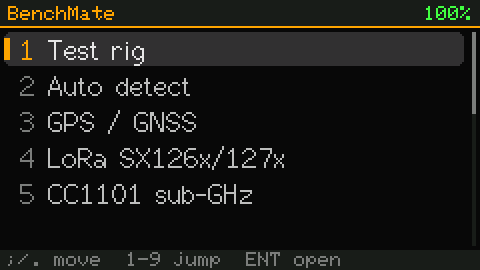
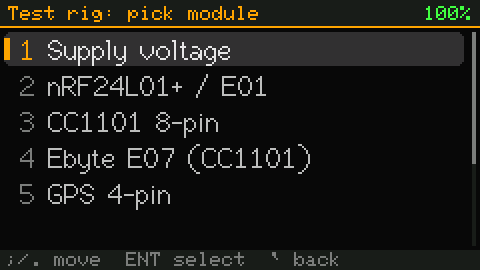
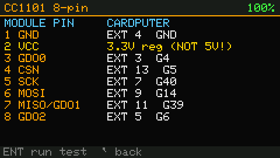
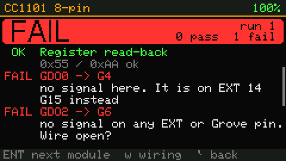
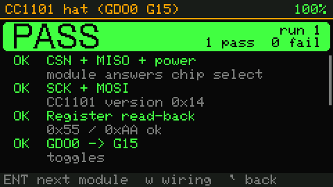

# BenchMate

Bench testing firmware for the **M5Stack Cardputer ADV**. Plug a module into the EXT header or Grove port and check that it's alive, configured right, and actually working on air.

| Tool | What it does |
|---|---|
| **Test rig** | Pick a module profile, see the wiring on screen, then run a pass/fail sequence that checks each signal wire and basic function. Profiles: nRF24L01+ / Ebyte E01, CC1101 8-pin, CC1101 hat (GDO0 on G15), Ebyte E07, 4-pin GPS, I2C environmental sensors (BME280/BMP280, SHT3x/4x, AHT10/20, SCD4x), PN532 NFC (I2C or UART), ESP32 boards via the ROM bootloader, supply voltage. Enter re-runs the test for the next module and keeps a pass/fail count. |
| **Auto detect** | Probes the EXT SPI bus for SX126x / SX127x / CC1101 / nRF24, scans both I2C buses, and listens for NMEA on EXT and Grove UARTs (both pin orders, common baud rates). |
| **GPS / GNSS** | Auto-baud, fix type, lat/lon/alt/HDOP, UTC, **time-to-first-fix**, checksum stats, per-satellite SNR bars (GPS/GLONASS/Galileo/BeiDou/QZSS), raw NMEA view. |
| **LoRa SX126x/127x** | Chip detect with TCXO auto-probe, RX packet monitor (RSSI/SNR), TX test packets (manual or every 2 s), live noise-floor graph. Freq, BW, SF, CR, power and sync word (private, LoRaWAN or Meshtastic) are all adjustable. |
| **CC1101 sub-GHz** | Chip detect and version, spectrum sweep with peak hold, RSSI meter, 2-FSK packet RX/TX. |
| **nRF24 2.4 GHz** | Chip detect (including a check for genuine L01+ vs. clone), 126-channel scanner with Wi-Fi channel overlay, packet RX/TX with optional auto-ACK. |
| **Voltmeter** | Live reading from an M5Stack Unit VMeter (ADS1115, ±36 V) on the Grove port, with min/max and a 3.3 V / 5 V rail check. Also available as the **Supply voltage** test rig profile. |
| **I2C scanner** | EXT/internal (G8/G9) or Grove (G2/G1) bus, address map, likely part names, on-board parts flagged. 10k/100k/400k. |
| **UART terminal** | Any baud from 1200 to 921600, ASCII or hex view, send lines with a chosen line ending, and a **loopback self-test** (jumper TX to RX). |
| **GPIO / logic probe** | Per pin: input (with pull-up/down), drive high/low, PWM (50 Hz–100 kHz, duty cycle), ADC in mV, or frequency counter. |
| **WiFi scan** | AP list with RSSI/channel/security, plus a channel occupancy chart. |
| **System info** | Battery, heap, IMU, MAC, uptime. |
| **Settings / pins** | Remap CS/IRQ/RST/AUX, SPI and UART pins, default frequencies and brightness. Saved to flash. |

## Screenshots

Captured from the device over USB.

| Main menu | Test rig profiles |
|---|---|
|  |  |

| Wiring screen (CC1101) | Failing result (GDO0 wired to a different pin) |
|---|---|
|  |  |

| Passing result (CC1101 hat) |
|---|
|  |

## Build and flash

Requires [PlatformIO](https://platformio.org/).

```bash
pio run -t upload
```

If upload doesn't start, hold **G0** (the button next to the USB port) while plugging in USB to enter download mode.

To flash it some other way (M5Burner, web flasher, or keeping it next to other firmware with [M5Launcher](https://github.com/bmorcelli/Launcher)), use these files:

- `.pio/build/cardputer-adv/firmware.factory.bin`: the full image, written at offset `0x0`
- `.pio/build/cardputer-adv/firmware.bin`: the app only, for Launcher

## Controls

| Key | Action |
|---|---|
| `;` `.` | up / down |
| `,` `/` | left / right (change value) |
| `Enter` | select / edit / send |
| `` ` `` (esc) or **G0** button | back |
| `Tab` | switch page or view inside a tool |
| `1`–`9` | jump to a menu item |

On text-entry screens (UART terminal, payload editor), `;.,/` type normally. Hold **Fn** to use them as arrows.

In a settings form you can start typing digits on a number field to type a value directly.

## USB remote and screenshots

The firmware listens on its USB serial port. Sending `Ctrl-P` (0x10) returns the current frame as a `BMSHOT <w> <h>` line followed by raw big-endian RGB565; any other byte is treated as that key being pressed. `tools/screenshot.py` uses this to drive the UI and save PNGs (Python 3, no extra packages):

```bash
python3 tools/screenshot.py out_dir s:menu 'k:\r' w:0.5 s:rig_menu
```

Steps are `k:<keys>` to press keys, `w:<seconds>` to wait and `s:<name>` to save a screenshot. Set `BENCHMATE_PORT` if the device is not on `/dev/cu.usbmodem101`.

## Wiring

Default pins follow the Cardputer ADV **EXT 2.54-14P** header, which is also what the M5 **Cap LoRa-1262** (SX1262 + GPS) uses, so that cap works with no setup.

```
EXT header (looking at the pins)
 1 RST   G3   |  2 5V IN
 3 INT   G4   |  4 GND
 5 BUSY  G6   |  6 5V OUT
 7 SCK   G40  |  8 SDA  G8
 9 MOSI  G14  | 10 SCL  G9
11 MISO  G39  | 12 TX   G13
13 CS    G5   | 14 RX   G15

Grove: yellow G2, white G1, red 5V, black GND
```

Module signals to connect:

| Module | CS | IRQ (G4) | RST (G3) | AUX (G6) | Power |
|---|---|---|---|---|---|
| SX1262/1268 (E22, Waveshare, Cap) | G5 | DIO1 | NRESET | BUSY | 3.3 V |
| SX1276-79 (RFM95, Ra-02) | G5 | DIO0 | RESET | DIO1 (optional) | 3.3 V |
| CC1101 | G5 | GDO0 | — | GDO2 | **3.3 V only** |
| nRF24L01(+) | G5 (CSN) | IRQ | — | **CE** | **3.3 V only**, add 10 µF cap |

All radios also need SCK/MOSI/MISO (G40/G14/G39) and GND.

> **Watch the voltage.** The EXT header and Grove port only supply 5 V. CC1101 and nRF24 modules are 3.3 V only, so power them through a 3.3 V regulator (an AMS1117 board or an nRF24 adapter), never straight from 5 V. Signal levels are 3.3 V.

GPS modules: connect the module's TX to ESP **RX (G15)** and its RX to **TX (G13)**. Sources disagree on which direction the Cap LoRa-1262's GPS lines run, so if you get nothing, set **Swap RX/TX** to yes. Auto detect tries both orders.

If you wire a module differently, change the pins under **Settings / pins**.

## Notes

- The microSD card shares the SPI bus. BenchMate holds the SD card's CS (G12) high so it stays out of the way.
- SX126x **TCXO = auto** tries 1.8 V, then no TCXO (crystal), then 1.6 V. It never tries 3.0 V automatically, so a 1.8 V TCXO can't be over-driven. Pick 3.0 V by hand only if your module's datasheet calls for it.
- RX and TX screens use the same settings on both ends. Two Cardputers running BenchMate, or BenchMate and any RadioLib sketch with matching settings, can test a link against each other.
- The nRF24 scanner reads the RPD bit, which is set above roughly −64 dBm, so it shows strong local activity rather than a calibrated spectrum.
- Only transmit on frequencies and at power levels you're licensed or permitted to use where you are.

## Project layout

```
src/
  main.cpp          menu + tool registry
  ui.*              canvas rendering, keyboard input, menu/form/text widgets
  config.*          pin config, NVS settings, shared SPI bring-up
  radio.*           RadioLib HAL, error text, generic packet RX/TX screens
  tool_*.cpp        one file per tool
```

To add a test rig profile, write a wiring function and a run function in `tool_rig.cpp` and add them to `PROFILES[]`.

To add a tool, write a `void toolX()` that runs its own loop until `K_BACK`, declare it in `tools.h`, and add it to `TOOLS[]` in `main.cpp`.
